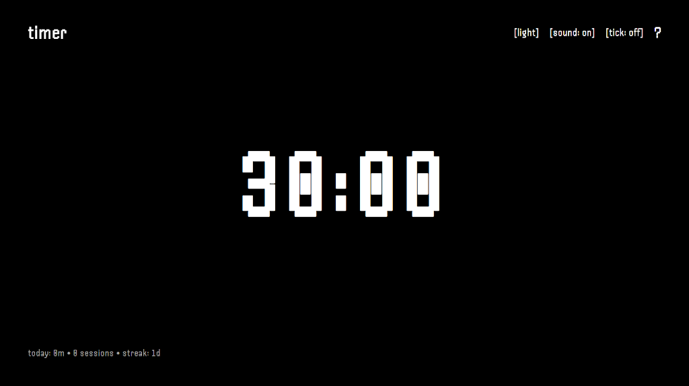
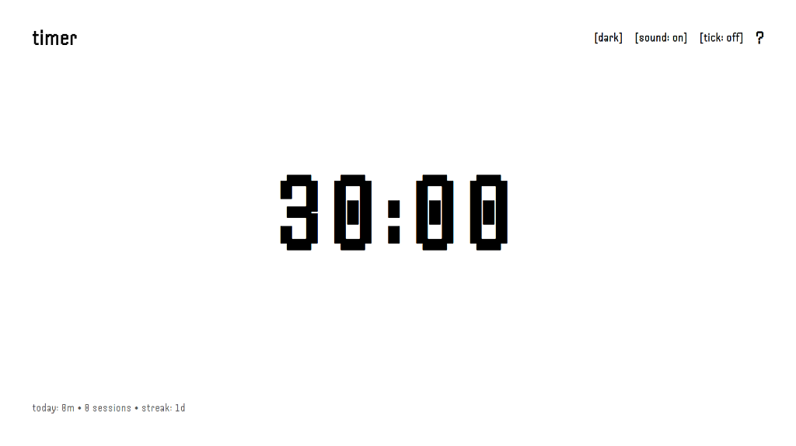
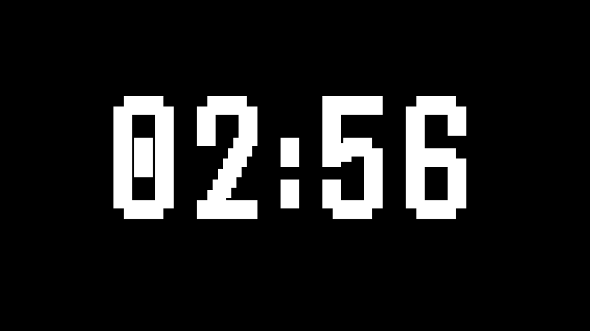
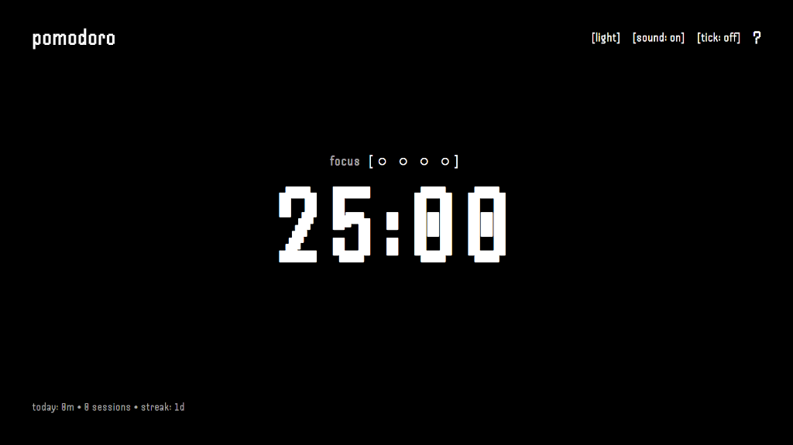
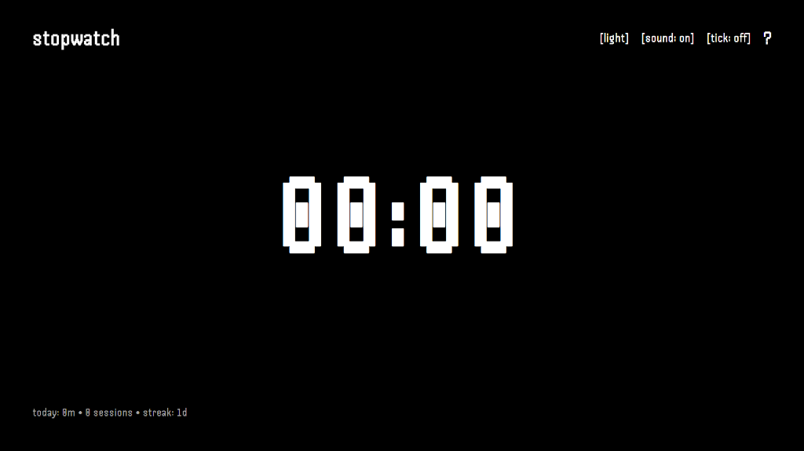
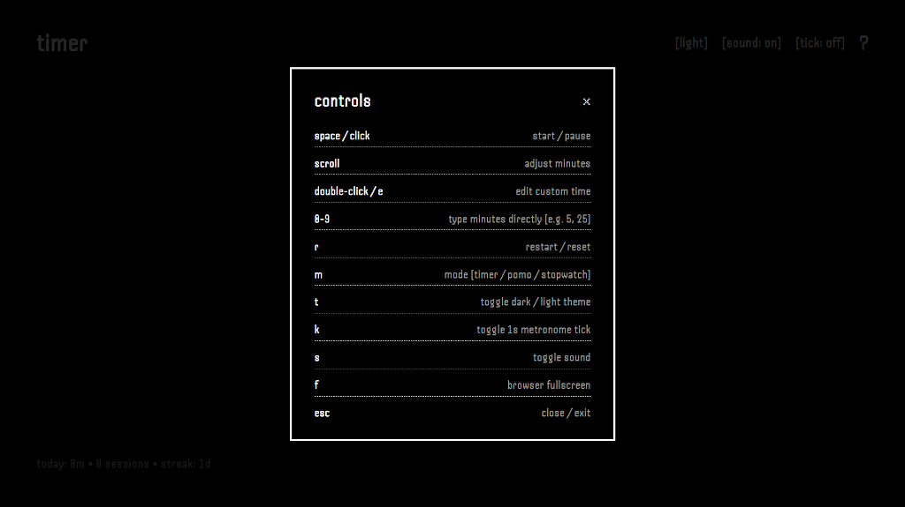

# ⏳ pixel timer

A minimal, self-made 8-bit retro pixel timer, Pomodoro tracker, and stopwatch designed for focus and simplicity. Built with pure HTML, Vanilla CSS, and JavaScript.

🌐 **Live Website**: [https://timer-three-psi-89.vercel.app/](https://timer-three-psi-89.vercel.app/)

## 📸 Screenshots

### Themes
| Dark Theme | Light Theme |
| :---: | :---: |
|  |  |

### Modes & Focus Display
| Running Focus State | Pomodoro Tracker |
| :---: | :---: |
|  |  |

| Stopwatch Mode | Controls & Shortcuts |
| :---: | :---: |
|  |  |

## ✨ Features

- **3 Modes**: Countdown Timer, Pomodoro Tracker (with 4-cycle indicator blocks), and Stopwatch.
- **8-Bit Sound Engine**: Custom square-wave chimes, alarm fanfare, and metronome ticks synthesized via Web Audio API.
- **Handjet Typography**: Crisp retro pixel font powered by Google Fonts.
- **Dark & Light Themes**: Quick toggle (`T`) matching your aesthetic.
- **Daily Focus Stats**: Automatically records daily focus time and active streaks in `localStorage`.
- **Keyboard, Mouse & Mobile Touch Controls**: Built for speed (`Space` / tap to start/pause, swipe up/down or scroll wheel to adjust minutes, quick `[-5, -1, +1, +5]` touch buttons, `[reset]` button when paused, `M` for mode, `0-9` to type minutes directly, `E` or `[edit]` to set custom time).
- **Full Mobile Optimization**: Safe-area support for iOS notches & home indicators, `100dvh` viewport handling, Web Audio unlock for mobile Safari, and zero horizontal overflow on small screens.

## 🚀 How to Use

No installation or dependencies required! You can use the timer directly online at:

👉 **[https://timer-three-psi-89.vercel.app/](https://timer-three-psi-89.vercel.app/)**

## ⌨️ Controls & Shortcuts

| Action | Desktop Key / Mouse | Mobile / Touch |
| --- | --- | --- |
| Start / Pause | `Space` / Click | Tap anywhere on screen |
| Adjust Minutes | `Scroll wheel` | Swipe Up / Down or tap `[-5] [-1] [+1] [+5]` |
| Custom Time | `E` / Double-click | Tap `[edit]`, input time, tap `[set]` |
| Direct Minutes | `0-9` (e.g. `5`, `25`) | Type on keyboard or use edit |
| Restart / Reset | `R` | Tap `[reset]` (visible when paused/completed) |
| Cycle Mode | `M` | Tap `timer` brand in header |
| Toggle Theme | `T` | Tap `[light]` / `[dark]` in header |
| Toggle Tick | `K` | Tap `[tick]` in header |
| Toggle Sound | `S` | Tap `[sound]` in header |
| Fullscreen | `F` | Browser fullscreen |
| Help / Shortcuts | `?` | Tap `?` in header |
| Close / Exit | `Esc` | Tap `×` or `[cancel]` |

---

*Built for simple, distraction-free focus.*
